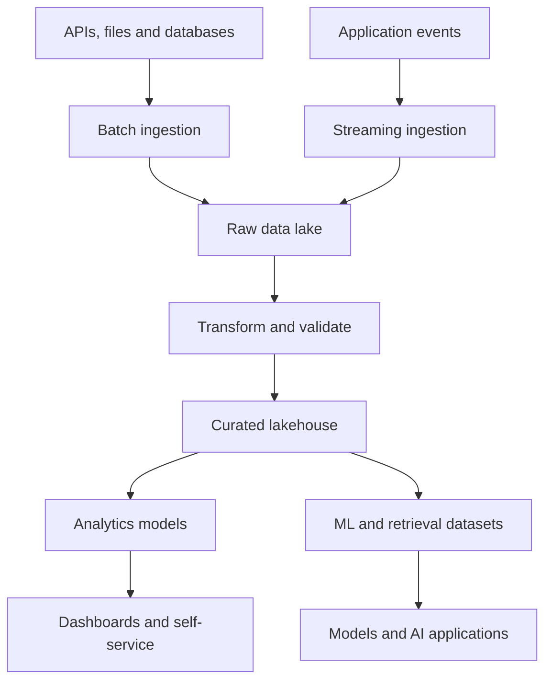

<!-- Profile README: place this file at the root of the public Adityak365/Adityak365 repository. -->

# Hi, I'm Aditya K 👋

### Building the data foundation for analytics & AI.

**Data Engineer · Cloud Platforms · Streaming Systems · Lakehouse Architecture**

I turn fragmented data into reliable pipelines, trusted datasets, and useful products.

📍 New Jersey, USA &nbsp; • &nbsp; 🎓 M.S. Data Science, Rutgers University–Camden

**Open to Data Engineer · Analytics Engineer · AI Data Engineer opportunities in the USA**

[About](#-about-me) · [Skills](#-technical-toolkit) · [Experience](#-experience) · [Projects](#-selected-projects) · [Connect](#-lets-connect)

---

## 👨‍💻 About Me

I'm a **Data Engineer with 3+ years of experience** building batch and streaming pipelines, cloud data platforms, and analytics-ready models. My work spans media platforms, pharmaceutical manufacturing, and AI data infrastructure.

I enjoy the engineering behind dependable data: incremental ingestion, distributed transformations, clear data contracts, and monitoring that catches issues before they reach users. I work closely with product teams, analysts, and ML engineers to connect these systems to real business needs.

- 🔭 **Currently:** AI training-data lakehouses, reproducible dataset releases, and RAG retrieval workflows at Scale AI.
- ⚙️ **Core strengths:** Python, SQL, Spark, AWS, Azure, Airflow, and dimensional modeling.
- 🧭 **Engineering focus:** Data quality, observability, governance, and performance.
- 🤝 **Collaboration:** Turning business requirements into datasets teams can confidently use.

## 📌 Impact at a Glance

| 📡 Streaming scale | 🏭 Daily ingestion | 🗂️ Curated datasets | ⚡ Reporting speed |
| :---: | :---: | :---: | :---: |
| **6–8 TB / day** | **2M+ records / day** | **50+ Gold datasets** | **2 hr → 20 min** |
| Media events at Jio | Manufacturing data at Pfizer | Delta Lake at Pfizer | SQL refresh optimization |

## 🛠️ Technical Toolkit

### Languages & Data Processing

### Cloud & Lakehouse Platforms

### Orchestration, Streaming & Transformation

### Storage, Delivery & Analytics

<b>View cloud services, data practices & supporting tools</b>

 

| Focus | Tools & practices |
| :--- | :--- |
| **AWS** | S3, EMR, Glue, Athena, Lambda, Redshift, Kinesis, Step Functions, SageMaker, OpenSearch |
| **Azure & Fabric** | ADF, ADLS Gen2, Databricks, Synapse, Azure SQL, Functions, Fabric Lakehouse, Direct Lake |
| **Modeling** | dbt, star schemas, fact and dimension tables, SCD Type 1/2, incremental models |
| **Reliability** | Great Expectations, dbt tests, reconciliation, freshness gates, SLA monitoring |
| **Governance** | Unity Catalog, Microsoft Purview, lineage, schema contracts, dataset versioning |
| **Performance** | Partitioned Parquet, Spark tuning, incremental processing, SQL execution plans and indexing |
| **Delivery** | GitHub, Docker, Azure DevOps, Jenkins, CloudWatch, Azure Monitor |
| **AI & ML data** | Embeddings, hybrid retrieval, RAG pipelines, feature engineering, MLflow, Pandas |
| **Additional storage** | SQL Server, MySQL, Oracle, Elasticsearch, BigQuery |

## 🧩 My Data Engineering Focus

| Build | Make dependable | Enable |
| :--- | :--- | :--- |
| Batch & streaming ingestion | Quality checks & reconciliation | Self-service analytics |
| Lakehouses & warehouses | Lineage & data contracts | Operational dashboards |
| Incremental data models | Monitoring & recovery | ML features & AI datasets |

### A reference pattern for the platforms I build

## 💼 Experience

| Company | Role | Period | Focus |
| :--- | :--- | :--- | :--- |
| **Scale AI** | AI Data Engineer | Oct 2026 – Present | AI training data, Iceberg lakehouse, RAG |
| **Pfizer** | Data Engineer Intern | Dec 2025 – Apr 2026 | Azure pipelines, manufacturing analytics, Fabric |
| **Jio Platforms** | Data Engineer | Nov 2021 – Jul 2024 | Streaming events, search, audience analytics |

<b>Scale AI · Governed data infrastructure for AI</b>

- Building an **Apache Iceberg lakehouse on S3** for pre-training, RLHF, and evaluation data, cataloged with Glue and queried through Athena.
- Developing **Spark transformations and reproducible dataset releases** with snapshot-based rollback and Step Functions orchestration.
- Building **chunking, embedding, and hybrid search workflows** using SageMaker and OpenSearch.
- Implementing quality checks, drift detection, data contracts, and freshness monitoring.

<b>Pfizer · Manufacturing & maintenance analytics</b>

- Ingested **2M+ records daily** using metadata-driven ADF pipelines and incremental loads into ADLS Gen2.
- Built a **Delta Lake medallion platform with 50+ Gold datasets** using PySpark and Databricks.
- Reduced reporting errors by **85%** through reconciliation, anomaly checks, lineage, and monitoring.
- Reduced SQL reporting refresh time from **2 hours to 20 minutes** through query and indexing improvements.
- Delivered curated data to Microsoft Fabric, Power BI, and Tableau for operational reporting.

<b>Jio Platforms · Streaming data at scale</b>

- Processed **6–8 TB of daily events** across media platforms serving **100M+ users**.
- Built pipelines with Kafka, Spark, EMR, Glue, and partitioned Parquet on S3.
- Developed incremental fact tables and SCD Type 2 dimensions with dbt and Snowflake.
- Supported multilingual search, automated content rankings, and recommendation feature pipelines.
- Improved pipeline SLA adherence from **87% to 95%** and reduced manual intervention by **65%** through Airflow automation and monitoring.

## 🚀 Selected Projects

<table>
<tr>
<td valign="top" width="50%">

### 🧠 AGORA
**Autonomous Multi-Agent AI Research Platform**

A four-agent workflow for question framing, evidence retrieval, hypothesis generation, and verification.

- PostgreSQL-backed evidence and persistent agent memory.
- Tavily retrieval and orchestration of multiple LLMs.
- Live results through server-sent events.
- Scheduled runs and Docker-based delivery.

**Stack:** TypeScript · PostgreSQL · Docker · Claude · GPT-4o-mini

<a href="https://github.com/Adityak365/agora"><b>Explore repository →</b></a>

</td>
<td valign="top" width="50%">

### 📈 Stock Price Prediction
**Hybrid CNN-LSTM-Attention Model**

A forecasting project connecting reliable data preparation with model training and evaluation.

- Airflow-based price ingestion and feature generation.
- Time-ordered windows that avoid look-ahead leakage.
- CNN-LSTM with attention for price and direction prediction.
- MLflow experiment tracking and held-out backtesting.

**Stack:** Python · PyTorch · Pandas · Airflow · MLflow

<a href="https://github.com/Adityak365?tab=repositories"><b>Browse my projects →</b></a>

</td>
</tr>
</table>

## 🎓 Education

| Degree | Institution | Details |
| :--- | :--- | :--- |
| **M.S. in Data Science** | Rutgers University–Camden | Aug 2024 – May 2026 · **GPA 3.9/4.0** |
| **B.S. in Computer Science (Honours)** | IIIT Ranchi | Computer Science |

## 🤝 Let's Connect

I'm interested in building data platforms that teams can trust and maintain. If you're hiring for **Data Engineering, Analytics Engineering, or AI Data Engineering** in the USA, I'd love to connect.

**[LinkedIn](https://www.linkedin.com/in/adityakprofile/) &nbsp; · &nbsp; [Portfolio](https://aditya-k-portfolio-blush.vercel.app/) &nbsp; · &nbsp; [Email](mailto:aditya.k365@outlook.com)**

`aditya.k365@outlook.com`

---

**Reliable pipelines. Trusted data. Useful outcomes.**

